# 🛡️ Databricks Fraud Detection

## ⚡ Quick Summary

Mobile-money apps move millions of payments a day, and a small share of them
are fraud. This project builds the system a bank's data team would use to
catch it, on **Databricks** (the data platform many large companies use for
this work) using only its free tier.

### Streaming fraud detection on a Databricks lakehouse, built in verified steps, measured rather than claimed

#### 🔁 How it works

- 📥 **Transactions flow in continuously** — a live stream of simulated mobile-money payments
- 🧹 **Cleaned and organised** — checked against quality rules, with copies removed
- 🤖 **Scored by a machine-learning model** — every new payment, after each load
- 🚨 **Suspicious ones become alerts** — surfaced on a dashboard for a fraud team

#### 🕒 What the hour numbers mean

The data is one **simulated month** of payments, counted in hours: hour 1 is day 1, midnight to 1 am, and the last one, hour 743, falls on day 31. Every 24 hours is one day, so **hour 480 is day 20, 11 pm**. The project replays that month a few hours at a time, as if it were happening live:

| Hours | Days | What they are used for |
|---|---|---|
| 1–336 | 1–14 | Teaching the fraud model |
| 337–408 | 15–17 | The test period: payments the model never saw, scored and turned into alerts |
| 409–480 | 18–20 | Replayed later to watch the system keep running (the newest hour loaded is 480) |

A fraud verdict arrives **3 simulated days (72 hours) after** the payment, just as real fraud is confirmed late. That is why the result charts stop at hour 408: hours 409–480 are still "waiting for verdicts". The dashboards show these hours as `Day 20, 23:00 (hour 480)`.

#### ✅ Built in phases, each proven with real runs

- 📥 **Phase 2 — Ingest (done)** — about **6 million** simulated transactions streamed in, and **every count matched exactly**
  - Deliberately staged problems were included: a file sent twice, a file that arrived late, a new column appearing mid-stream, and corrupted values
- 🧹 **Phase 3 — Clean (done)** — payments checked against quality rules, copies removed, and bad rows set aside with the reason
  - Each payment gets warning signs, such as how many payments its receiving account got in the previous 24 hours
  - Every count again matched an independent calculation exactly
- 🤖 **Phase 4 — Score (done)** — a fraud model trained on those warning signs scores every new payment after each load
  - With the same **50 alerts per hour** a review team could handle, it catches **405 of the 822 frauds** in the test period, more than any simpler rule
  - Every score is logged with the model version that made it
- 🗂️ **Phase 5 — Alerts and access (done)** — each hour's 50 riskiest payments become alerts that never change once issued
  - Each alert opens a case, and cases close three simulated days later with a verdict
  - Who sees what is enforced by the platform itself: managers see only closed cases and never a customer's account name
  - Proven with a second, real user account, including taking access away and giving it back
- 📊 **Phase 6a — Monitoring (done, `v0.5.0`)** — two dashboards, one for the fraud team and one for engineers, rebuilt after every load
  - Every number on them matched an independent calculation from the data, including the model's **405 of 822** frauds caught
  - A manager sees the same totals but no open cases and no engineering pages, proven with the second user account
  - Designed to be read at a glance: one colour theme, green for good and red for bad on every chart, and sliders, click-to-filter and drill-through to a single job run

---

## 🏷️ Project Badges

[](https://www.databricks.com/)
[](https://spark.apache.org/)
[](https://docs.databricks.com/aws/en/ingestion/cloud-object-storage/auto-loader/)
[](https://delta.io/)
[](https://docs.databricks.com/aws/en/data-governance/unity-catalog/)
[](https://docs.databricks.com/aws/en/dev-tools/bundles/)
[](https://mlflow.org/)
[](https://scikit-learn.org/)
[](https://docs.databricks.com/aws/en/sql/)
[](https://docs.databricks.com/aws/en/dashboards/)

[](https://www.python.org/)
[](tests/README.md)
[](https://github.com/deepan-mehta-analytics/databricks-fraud-detection/actions)
[](https://github.com/deepan-mehta-analytics/databricks-fraud-detection/releases)
[](PROJECT-STATUS.md)
[](docs/exam-guide-map.md)
[](LICENSE)

---

## 📌 Project Overview

This project implements **an event-driven fraud pipeline on the Databricks
lakehouse**. Every architecture claim is checked against current docs or a
real run before it is adopted.

It uses the [PaySim](https://www.kaggle.com/datasets/ealaxi/paysim1)
mobile-money simulation (6.36M transactions) and replays it as a live event
stream through **Auto Loader into a Unity Catalog medallion layout**.

**✅ Implemented and verified (Phase 2: ingest to Bronze)**

- **Replayable event stream**: a splitter turns the CSV into 743 hourly JSON Lines files, and a release task drops them into a landing volume a few hours at a time
- **Auto Loader ingest**: incremental file discovery, pinned schema hints, `addNewColumns` schema evolution, rescued data, and an exactly-once checkpoint on a UC Volume
- **Staged failure scenarios**: duplicate delivery, late arrival, a new column mid-stream and malformed values, each switched on per run and each proven with a SQL check
- **Jobs as code**: a Databricks job (release → ingest → silver, plus a `score` task from Phase 4, a `gold` SQL task from Phase 5, and a `monitor` SQL task with two dashboard refreshes from Phase 6a) and the Silver pipeline, declared in an Asset Bundle with shared catalog/schema variables and deployed from the workspace UI, with no token
- **Guarded parameters**: scenario settings that can't take effect raise an error before any file is copied
- **Tested and CI-gated**: 236 local unit tests, and a GitHub Actions job running hygiene checks plus tests on every push
- **Exam-skills coverage map**: every Data Engineer Associate exam item mapped to repo evidence (18 of 33 shown), with short concept notes in [`docs/concepts/`](docs/concepts/)

**✅ Implemented and verified (Phase 3: Silver)**

- **Declarative pipeline**: a Lakeflow pipeline of four SQL materialized views, run as a job task after ingest, serverless and triggered
- **Quality rules with quarantine**: every Bronze row gets a verdict; nine expectations count each rule on the Data quality tab, clean rows go to `silver_transactions` (with fail-loud guards), and rejected rows go to a shelf with their reason
- **Duplicate handling**: the first arrival of each `transaction_id` is kept, identical copies are dropped and counted, and conflicting copies are rejected
- **Point-in-time features**: six receiver features (the "mule account" signal) and one sender feature, from earlier hours only, with no leakage from the same hour
- **Late data corrected**: a file released late updates the affected features on the next refresh, which was proven in a staged run
- **Measured refresh**: the full build and the later incremental refreshes were read from the pipeline event log, not assumed

**✅ Implemented and verified (Phase 4: model training and batch scoring)**

- **Model training job**: an on-demand `fraud-train` job fits gradient-boosted trees and a logistic baseline in scikit-learn, picks the winner on a later time window, and logs both to MLflow
- **Unity Catalog model registry**: each winner becomes a new version of `fraud_model` marked `@challenger`; a promotion step moves `@champion`, and scoring picks it up with no redeploy
- **Batch scoring after every load**: a `score` task after Silver scores only payments not scored before, so reruns never score twice
- **Decision log**: every score is stored with the model version and the exact inputs the model saw
- **Measured against baselines**: precision and recall at 50 alerts per hour, plus PR-AUC, against "largest amount first", PaySim's old rules and a logistic regression
- **Label delay measured**: a model trained without the latest 3 days of labels (as a real bank must) is compared with one that saw them

**✅ Implemented and verified (Phase 5: Gold alerts and governance)**

- **Append-only alert log**: a `gold` SQL task on the SQL warehouse writes the top 50 payments per simulated hour, never re-ranks an alerted hour, and handles late payments with a fill-or-beat rule; a rerun writes 0 rows
- **Case table with verdicts**: one case per alert, closed 72 simulated hours later with a verdict (simulated from the dataset's label, the only Gold statement that reads it)
- **Managers' summary view**: a plain view of per-hour totals that stores nothing and is always current
- **Three groups, least privilege**: engineers get a schema-wide grant, reviewers and managers get grants table by table
- **Row filter and column masks**: managers see closed cases only, with account names `REDACTED`, and the rule holds through the view; proven with a second user, including `REVOKE` and `GRANT`
- **Tag-based policy probe**: a governed tag and one schema-level policy masked a scratch table, showing ABAC works on Free Edition
- **Measured limits**: an external table on Cloudflare R2 was designed, but Free Edition can't reach R2, so it is documented, not wired in

**✅ Implemented and verified (Phase 6a: monitoring view, `v0.5.0`)**

- **Six plain monitoring views** rebuilt by a `monitor` SQL task after every load: model results per hour, hours still waiting for verdicts, data freshness, rejected rows, and job and pipeline run times read from `system.lakeflow` by name
- **Two AI/BI dashboards as code**: *Fraud operations* for all three groups (each viewer's own grants, so the row filter and masks apply) and *Platform health* for engineers, built from commented Python and deployed with the bundle; every chart has a plain "How to read it" line and each dashboard ends with a word list
- **A designed look**: one theme on both dashboards, meaning colours pinned to values (green succeeded, red failed or fraud, grey cancelled or false alarm, always beside a ✓ or ✕), pastel table cells for slow runs and stages behind, and hours shown as `Day 20, 23:00` rather than bare numbers
- **Interactions**: hour sliders, click-to-filter between charts that share data, and drill-through from a run to a Run detail page and from a reviews hour to the model page
- **Status**: deployed 2026-10-15, checked 2026-10-15 to 2026-10-28 (D1–D17): a test run of 59 more hours took 17m 9s with all 8 tasks green, every view number (5,033 alerts, 405 of 822 frauds caught, 72 hours waiting) matched the CSV calculation, the run history matched the Jobs page, a manager saw the same totals with no open cases or engineering pages, and every restyle and interaction check passed

**🔜 Planned**

- **Phase 6b**: job alerting · **Phase 6c**: model monitoring

**🧭 Engineering principles**

- **Research first**: every claim in the original brief is re-verified and logged in [`docs/GAPS.md`](docs/GAPS.md) before adoption
- **Measured results only**: no number is reported unless it came from a real run
- **Decisions on record**: twelve ADRs in [`docs/adr/`](docs/adr/) capture each choice and what it cost, summarised in [Key Design Choices](#-key-design-choices)
- **Cost-disciplined and public-safe**: free tier only, placeholders for every workspace identifier

---

## ⚙️ Tech Stack

| Layer | Tool | Purpose |
|---|---|---|
| ☁️ Platform | Databricks Free Edition (serverless) | Compute, jobs, SQL warehouse; limits verified (G-08) |
| 📥 Ingestion | Auto Loader (`cloudFiles`) | Incremental JSON Lines ingest with schema hints, evolution and rescued data |
| 🔄 Stream engine | Spark Structured Streaming, `Trigger.AvailableNow` | Batch-style streaming, the trigger serverless supports (G-02) |
| 🗄️ Storage | Delta Lake | Append-only Bronze table, release log, scoring decision log, Gold alert log and case table |
| 🥈 Transformation | Lakeflow declarative pipeline (SQL materialized views, expectations) | Silver: quality rules, quarantine, dedup and strict-past window features, refreshed incrementally on serverless |
| 🥇 Gold | Databricks SQL: SQL file task on the serverless SQL warehouse, Delta `MERGE` | Append-only alert log, case table and a plain summary view; warehouse found by name at deploy time |
| 🏛️ Governance | Unity Catalog: schema, 4 Volumes, 3 groups, grants, row filter, column masks, governed tags | Files, checkpoints and tables under one namespace; per-group access proven with a second user (G-06), tag-based policy probed (G-19) |
| 💾 Checkpoints | Unity Catalog Volume | DBFS root is deprecated (G-03) |
| 🤖 ML | scikit-learn 1.7.2, MLflow, Unity Catalog model registry | Gradient-boosted trees vs a logistic baseline, experiment tracking, versioned models with `@champion` / `@challenger` aliases |
| 🧩 Orchestration | Databricks Jobs + Asset Bundle (`databricks.yml`) | Eight-task ingest job (release, ingest, the Silver pipeline task, score, a `gold` and a `monitor` SQL task on the SQL warehouse, found by name at deploy time, then two dashboard refreshes), an on-demand training job, the pipeline and two dashboards, as code, deployed from the workspace UI (G-11) |
| 📊 Monitoring | AI/BI dashboards (`.lvdash.json` built from Python), plain views over Gold, Silver and `system.lakeflow` | Fraud operations and platform health pages with one theme, sliders, cross-filtering and drill-through; verified 2026-10-15 to 2026-10-28 ([ADR 0012](docs/adr/0012-monitoring-dashboards-and-views.md)) |
| 🔗 Code delivery | Databricks Git folder | Workspace runs use this repo at a known commit (G-12) |
| 🐍 Language | Python 3.11, SQL | Splitter, release logic, scenario transforms, local Silver and Gold reference models (stdlib only); model code with scikit-learn and pandas; Silver and Gold in SQL |
| 🧪 Testing | pytest (236 tests), PyYAML | Contract, split, scenarios, release, ingest options, job and pipeline definitions, Silver reference model and SQL guards, model windows, features, metrics, training and scoring, Gold calculator and Gold/governance SQL guards, monitoring SQL and dashboard guards |
| ⚙️ CI | GitHub Actions | Hygiene check + unit tests on every push |
| 📊 Data | PaySim (CC BY-SA 4.0) | Synthetic mobile-money transactions with fraud labels |

---

## 🎯 Business Problem

Fraud teams need suspicious payments flagged fast, from data that arrives
continuously and messily: late, duplicated, with changing formats. Real
streaming stacks (Kafka, dedicated clusters) are expensive to run, and on
this free tier they are blocked outright (G-01).

> **How quickly can a mobile-money transaction be flagged as likely fraud,
> and can the whole path — messy ingest to alert — be shown end to end on
> free infrastructure, with every number measured?**

---

## 🏗️ Architecture

```mermaid
flowchart LR
    CSV[("📄 paysim.csv<br/>6.36M rows")]

    subgraph UC["🏛️ Unity Catalog · workspace.fraud"]
        direction LR
        RAW[("raw<br/>volume")]
        OUT[("outbox<br/>743 hourly files")]
        LAND[("landing<br/>volume")]
        STATE[("pipeline_state<br/>schema + checkpoint")]
        LOG[["release_log<br/>Delta table"]]
        BRONZE[["🥉 bronze_transactions<br/>Delta table"]]
    end

    subgraph JOB["🧩 fraud-ingest job · Asset Bundle"]
        direction TB
        REL["02_release<br/>next K steps + scenarios"]
        ING["03_ingest_bronze<br/>Auto Loader · AvailableNow"]
        REL -->|then| ING
    end

    SPLIT["01_prepare_outbox<br/>one-time split"]

    CSV -->|upload| RAW --> SPLIT --> OUT
    OUT --> REL
    REL -->|copy files| LAND
    REL -->|log each step| LOG
    LAND --> ING
    ING <-->|schema + offsets| STATE
    ING -->|append| BRONZE

    subgraph PIPE["🥈 fraud-silver pipeline · job task 3"]
        direction TB
        CHK["silver_checked_transactions<br/>private · verdict + expectations"]
        CLEAN[["silver_transactions<br/>clean payments"]]
        REJ[["silver_rejected_transactions<br/>rejected + reason"]]
        FEAT[["silver_transaction_features<br/>strict-past features"]]
        CHK -->|ok| CLEAN
        CHK -->|rule broken| REJ
        CLEAN --> FEAT
    end

    ING -->|then| CHK
    BRONZE --> CHK

    subgraph MODEL["🤖 Model · MLflow + Unity Catalog"]
        direction TB
        TRAIN["04_train_model<br/>fraud-train job · on demand"]
        REG[("fraud_model<br/>@champion · @challenger")]
        SCORE["05_score_transactions<br/>job task 4"]
        SCORES[["transaction_risk_scores<br/>decision log"]]
        TRAIN -->|register| REG
        REG -->|load @champion| SCORE
        SCORE -->|append new only| SCORES
    end

    FEAT --> TRAIN
    FEAT --> SCORE

    subgraph GOLD["🥇 Gold · gold SQL task · job task 5"]
        direction TB
        ALERTS[["fraud_alerts<br/>append-only · top 50 per hour"]]
        CASES[["alert_cases<br/>open → closed + verdict"]]
        SUMMARY["alert_summary_hourly<br/>plain view"]
        ALERTS -->|open a case| CASES
        CASES --> SUMMARY
    end

    SCORES -->|insert new only| ALERTS
    CLEAN -.->|label, when closing| CASES

    GOV{{"🔐 Governance<br/>3 groups · row filter · masks"}}
    GOV -.-> CASES
    GOV -.-> ALERTS

    subgraph MON["📊 Monitoring · job tasks 6–8"]
        direction TB
        VIEWS["monitor SQL task<br/>6 plain views, re-granted"]
        SYS[("system.lakeflow<br/>job + pipeline history")]
        DASH["2 AI/BI dashboards<br/>viewer credentials"]
        SYS --> VIEWS
        VIEWS -->|refresh tasks| DASH
    end

    SUMMARY --> VIEWS
    CASES --> VIEWS
    GOV -.-> DASH

    classDef planned fill:#f5f5f5,stroke:#999,stroke-dasharray:4 3,color:#666
    classDef done fill:#e8f5e9,stroke:#2e7d32,color:#1b5e20
    class REL,ING,SPLIT,BRONZE,CHK,CLEAN,REJ,FEAT,TRAIN,REG,SCORE,SCORES,ALERTS,CASES,SUMMARY,GOV,VIEWS,SYS,DASH done
```

*Green nodes are built and verified. Dotted arrows show the label read when closing cases and where governance applies; the dashboards apply each viewer's own grants.*

| Component | Type | Role |
|---|---|---|
| `01_prepare_outbox` | Notebook (one-time) | Splits the CSV into 743 per-hour JSON Lines files, 336 backfill / 72 replay / 335 drift |
| `02_release` | Job task 1 | Copies the next K steps into `landing`, applies any scenario flags, logs each step |
| `03_ingest_bronze` | Job task 2 | Auto Loader stream: reads new landing files, appends to Bronze, stops when caught up |
| `release_log` | Delta table | One row per released or held step, the replay pointer |
| `bronze_transactions` | Delta table | Raw events plus `source_file`, `file_arrived_at`, `ingested_at`, `_rescued_data` |
| `pipeline_state` | UC Volume | Auto Loader schema location and streaming checkpoint |
| `silver_checked_transactions` | Private materialized view | Every Bronze row plus its verdict; nine warn expectations count each rule |
| `silver_transactions` | Materialized view | Clean payments: first copy only, fixed columns, three fail-loud guards |
| `silver_rejected_transactions` | Materialized view | Rows that broke a rule or conflicted, with `rejection_reason` and the raw evidence |
| `silver_transaction_features` | Materialized view | 6 receiver features + 1 sender feature, earlier hours only |
| `04_train_model` | `fraud-train` job (on demand) | Fits trees and a logistic baseline, compares them on a later window, registers the winner as `@challenger` |
| `fraud_model` | Unity Catalog model | Versioned models; `@champion` is the one scoring uses |
| `05_score_transactions` | Job task 4 | Scores new Silver payments from hour 337 with `@champion` |
| `transaction_risk_scores` | Delta table | Append-only decision log: score, model version, time and the inputs as seen |
| `06_promote_model` / `07_evaluate_model` | Notebooks (owner-run) | Move `@champion`; evaluate any version against the baselines |
| `sql/gold/gold.sql` | Job task 5 (SQL file, SQL warehouse) | Refuses to run outside `fraud_engineers`; adds new alerts, opens cases, closes 72-hour-old cases |
| `fraud_alerts` | Delta table | Append-only alert log: top 50 per hour, ties to the smaller ID, late alerts flagged |
| `alert_cases` | Delta table | One case per alert, `open` → `closed` with a verdict; row filter and masks attached |
| `alert_summary_hourly` | View | Per-hour alerts, closed cases, confirmed fraud and false alarms; stores nothing |
| `sql/50_governance.sql` | SQL (owner-run once) | Mask and filter functions, attaching them, and the group grants |
| `sql/52_abac_probe.sql` | SQL (owner-run probe) | Tag-based policy on a 5-row scratch table, then clean-up |
| `sql/monitoring/monitoring.sql` | Job task 6 (SQL file, SQL warehouse) | Recreates and re-grants six plain monitoring views; stores nothing (Phase 6a) |
| `refresh_operations` / `refresh_platform` | Job tasks 7–8 (dashboard tasks) | Refresh the two dashboards after the views are rebuilt (Phase 6a) |

| Phase | Layer | Status |
|---|---|---|
| 0 | Research, gaps register, ADRs | ✅ 22 of 22 gaps resolved (ADRs proposed, awaiting review) |
| 1 | Scaffolding, CI | ✅ Done |
| 2 | Ingest to Bronze | ✅ Verified 2026-09-24 |
| 3 | Silver and features | ✅ Verified 2026-10-06/07 (S1–S6) |
| 4 | Training and scoring | ✅ Verified 2026-10-08 to 2026-10-11 (M1–M8) |
| 5 | Gold alerts and governance | ✅ Verified 2026-10-11 to 2026-10-13 (G1–G11; G9 dropped, R2 unreachable) |
| 6 | Monitoring view (6a), alerting (6b), model monitoring (6c) | 🔄 6a ✅ verified 2026-10-15 to 2026-10-28 (D1–D17), released `v0.5.0`; 6b and 6c planned |
| 7 | Live demo window and teardown | ⏳ |

---

## 📁 Repository Structure

```
databricks-fraud-detection/
│
├── src/fraud_ingest/              ← stdlib-only package, unit-tested locally
│   ├── contract.py                ← record contract: segments, file names, IDs, timestamps, schema hints
│   ├── split.py                   ← CSV → 743 hourly JSON Lines files
│   ├── scenarios.py               ← schema-change and malformed-value transforms
│   ├── release.py                 ← release pointer, flag validation, per-run copy
│   ├── release_log.py             ← in-memory + Delta release-log stores
│   └── ingest.py                  ← Auto Loader options and stream builder
├── src/fraud_model/               ← Phase 4 model code, unit-tested locally (no Spark)
│   ├── windows.py                 ← training/comparison windows, label delay, defaults
│   ├── features.py                ← the one feature builder for training, scoring and evaluation
│   ├── metrics.py                 ← precision/recall at 50 alerts per hour, PR-AUC
│   ├── training.py                ← model builders, comparison, scoring helper, importances
│   ├── scoring.py                 ← scoring decision-log schema and rows
│   └── runtime.py                 ← library-version and "no model yet" guards
├── src/fraud_silver/expected.py   ← local Silver reference model (expected counts and features)
├── src/fraud_gold/expected.py     ← local Gold reference model (alerts per hour, closed cases, late-alert rule, monitoring tallies)
├── src/fraud_monitoring/dashboards.py ← the two dashboards as commented Python (pages, charts, plain words)
├── scripts/expected_silver.py     ← prints the expected Silver numbers from data/paysim.csv
├── scripts/expected_gold.py       ← prints the expected Gold numbers from data/paysim.csv (--monitoring for Phase 6a)
├── scripts/build_dashboards.py    ← writes dashboards/*.lvdash.json from the builder
│
├── pipelines/                     ← Lakeflow pipeline sources (see pipelines/README.md)
│   └── silver/
│       ├── 01_checked_transactions.sql  ← private verdict view + 9 expectations
│       ├── 02_transactions.sql          ← clean payments + fail guards
│       ├── 03_rejected_transactions.sql ← rejected shelf with reason
│       └── 04_transaction_features.sql  ← strict-past window features
│
├── notebooks/                     ← Databricks entry points
│   ├── 01_prepare_outbox.py       ← one-time split (V1)
│   ├── 02_release.py              ← job task: release next steps
│   ├── 03_ingest_bronze.py        ← job task: Auto Loader → Bronze
│   ├── 04_train_model.py          ← fraud-train job: fit, compare, register @challenger
│   ├── 05_score_transactions.py   ← job task: score new payments with @champion
│   ├── 06_promote_model.py        ← owner-run: move @champion to a version
│   ├── 07_evaluate_model.py       ← owner-run: after-the-fact evaluation vs baselines
│   └── 99_reset.py                ← drop state to rerun from scratch
│
├── sql/
│   ├── 10_fraud_ingest_setup.sql  ← schema, 4 volumes, release_log (run once)
│   ├── 20_verify_bronze.sql       ← V2–V4 checks + one-row check of every proof
│   ├── 30_silver_setup.sql        ← Bronze table properties for incremental refresh
│   ├── 31_verify_silver.sql       ← Silver checks S2–S6
│   ├── 40_verify_model.sql        ← model checks M4, M5, M7
│   ├── gold/gold.sql              ← job task: alert log, case table, summary view
│   ├── gold/export.sql            ← R2 export design (not wired: R2 unreachable on Free Edition)
│   ├── 50_governance.sql          ← mask, row filter and group grants (run once)
│   ├── 51_export_setup.sql        ← external table setup for a workspace that can reach R2
│   ├── 52_abac_probe.sql          ← tag-based policy probe on a scratch table
│   ├── 53_verify_gold.sql         ← Gold checks G3–G10
│   ├── monitoring/monitoring.sql  ← job task: six plain monitoring views, re-granted
│   ├── 60_probe_system_tables.sql ← system.lakeflow probe record
│   └── 61_verify_monitoring.sql   ← monitoring checks D3a–D8 and D12
│
├── dashboards/                    ← generated AI/BI dashboards: fraud_operations, platform_health
│
├── resources/
│   ├── fraud_ingest_job.yml       ← job: release → ingest → silver → score → gold → monitor → 2 dashboard refreshes, retries, paused schedule
│   ├── fraud_dashboards.yml       ← the two dashboards, viewer credentials, group permissions
│   ├── fraud_train_job.yml        ← on-demand training job
│   └── fraud_silver_pipeline.yml  ← Silver Lakeflow pipeline (serverless, triggered)
├── databricks.yml                 ← Asset Bundle root (dev target, catalog/schema variables, warehouse lookup)
│
├── tests/                         ← 236 pytest tests (see tests/README.md)
├── docs/
│   ├── adr/                       ← ADRs 0001–0012
│   ├── GAPS.md                    ← brief-vs-reality register + accepted limitations
│   ├── ENGINEERING-DECISIONS.md   ← decision log
│   ├── cost-model.md              ← free-tier cost tracking
│   ├── exam-guide-map.md          ← DE Associate skills-coverage map (33 items)
│   ├── exam-guide-delta.md        ← log of each re-check against the exam guide
│   ├── concepts/                  ← short plain-English notes for each shown skill
│   ├── img/monitoring/            ← dashboard screenshots and two interaction GIFs (Phase 6a)
│   └── 00-initial-brief.md        ← original non-binding brief
│
├── app/                           ← reserved: Phase 6a uses AI/BI dashboards instead
├── data/                          ← local datasets (gitignored)
├── .github/workflows/ci.yml       ← hygiene + unit-test jobs
├── Makefile                       ← check-hygiene, test (lint/deploy/teardown: honest stubs)
├── pyproject.toml                 ← pytest config
├── requirements-dev.txt           ← pytest, PyYAML, scikit-learn, pandas
├── .env.example                   ← placeholder configuration
├── LICENSE                        ← MIT
└── PROJECT-STATUS.md              ← phase tracker
```

---

## ▶️ How to Run

### 💻 Option 1: Local unit tests (no Databricks needed)

#### 1. Clone and install
```bash
git clone https://github.com/deepan-mehta-analytics/databricks-fraud-detection.git
cd databricks-fraud-detection
python -m pip install -r requirements-dev.txt
```

#### 2. Run the checks
```bash
python -m pytest -q      # 236 unit tests (or: make test)
make check-hygiene       # no local-only or secret file is tracked
make help                # lint / deploy / teardown are stubs until their phase lands
```

### ☁️ Option 2: Databricks Free Edition workspace

This is the path used for the Bronze (2026-09-24), Silver (2026-10-06/07),
model (2026-10-08 to 2026-10-11), Gold (2026-10-11 to 2026-10-13) and
monitoring (2026-10-15 to 2026-10-28) verifications. Every step is done by hand in the workspace UI.

1. **Git folder**: Workspace → Home → Create → Git folder → this repo's URL. A public clone needs no token (G-12)
2. **Setup SQL**: in the SQL editor, on a **SQL warehouse**, run `sql/10_fraud_ingest_setup.sql` once
3. **Data**: download PaySim, then Catalog → `workspace.fraud.raw` → upload `paysim.csv`
4. **Split (V1)**: run `notebooks/01_prepare_outbox` on serverless; it prints `V1 passed`
5. **Deploy the job**: open `databricks.yml` → deployments icon 🚀 → target `dev` → Deploy (G-11). Deploy again after any pull that adds or changes a job task: a pull only updates the code files, while the job's task list changes only on deploy
6. **Run the job** in this order. Scenario settings go in **Run now ⌄ → Run now with different settings**, which applies them to that run only; never edit the job's defaults:

   | Run | Settings | Releases |
   |---|---|---|
   | 1 | none | backfill, steps 1–336 |
   | 2 | none | 337–342 |
   | 3 | `duplicate_step=340`, `hold_steps=345` | 343–348 without 345, plus a copy of 340 |
   | 4 | `malformed_step=350`, `malformed_rows=5` | 349–354 |
   | 5 | `release_held=true`, `schema_change_from_step=360` | 355–360 plus the late 345; ingest fails once, then retries |
   | 6 | `steps_per_run=48` | 361–408 |
   | 7 | none | nothing: prints "Nothing to release" |

   The `silver` task runs after ingest in every run above. If the pipeline is deployed only after Bronze already exists, do step 8 first, then run the job once with no settings.

7. **Verify Bronze**: run the one-row check at the end of `sql/20_verify_bronze.sql` and compare with the Results below
8. **Silver setup**: run `sql/30_silver_setup.sql` once Bronze exists. It turns on the table features that incremental refresh needs (deletion vectors, row tracking, change data feed)
9. **Verify Silver**: run the S2–S6 queries in `sql/31_verify_silver.sql`. The expected values are written inline. The S6 queries need the pipeline ID from the `fraud-silver` page, typed in the editor only
10. **Reset**: `notebooks/99_reset` drops the state and prints the rebuild order: re-ingest, run `30_silver_setup.sql`, then **Full refresh all** on the pipeline
11. **Train** (after the replay above): Jobs & Pipelines → `fraud-train` → Run now. It registers a new `fraud_model` version as `@challenger`. Run it again with `label_delay_days=0` to measure the label-delay cost
12. **Promote**: run `notebooks/06_promote_model` with `version` set to the version to score with. If the widget bar doesn't show, call it from a scratch notebook outside the Git folder: `dbutils.notebook.run("<path>/06_promote_model", 600, {"version": "1"})`
13. **Score**: run `fraud-ingest` again. The `score` task scores every unscored Silver payment from hour 337 and prints `Scored N new payments …`. Check it with `sql/40_verify_model.sql`
14. **Evaluate**: run `notebooks/07_evaluate_model` the same way, with `model_uri` = `models:/workspace.fraud.fraud_model/<version>`. It prints the model's and the baselines' metrics and logs them to the model's MLflow run

15. **Gold setup**: create the groups `fraud_engineers`, `fraud_reviewers` and `fraud_managers` (Settings → Identity and access → Groups → Add new group to account and workspace) and add yourself to the first two, never to managers: the `gold` task refuses to run unless its identity is an engineer. The bundle finds the SQL warehouse by name (`databricks.yml`, default "Serverless Starter Warehouse"); edit the name if yours differs, then deploy
16. **Gold**: run `fraud-ingest`. Its `gold` task creates the alert log, the case table and the view on the first run, then adds alerts and closes cases on every run. Print the expected numbers locally with `python scripts/expected_gold.py --csv data/paysim.csv` and compare them with the G3–G5 blocks of `sql/53_verify_gold.sql`
17. **Governance**: run `sql/50_governance.sql` once, after the first Gold run. To see the rules work, invite a second user, add them to `fraud_managers`, and run the G6-manager block as them; `sql/52_abac_probe.sql` walks through the tag-based policy probe

18. **Monitoring**: Pull, then Deploy. That adds the `monitor` task, the two dashboard refreshes and the dashboards *Fraud operations* and *Platform health*. After the next `fraud-ingest` run, open them from **Dashboards**. Platform health is refreshed by the job before Databricks records that run, so click **Refresh** on it about an hour later. Print the expected numbers with `python scripts/expected_gold.py --csv data/paysim.csv --monitoring` and compare them with `sql/61_verify_monitoring.sql`: each after-run block returns one row ending in `all_as_expected`. Dashboard changes go through `src/fraud_monitoring/dashboards.py`: run `python scripts/build_dashboards.py`, commit the regenerated JSON, then Pull and Deploy. Never edit the deployed dashboard in the UI, because the next deploy overwrites it

The daily compute limit fits about 3–4 full job runs (G-08), so spread steps 11–17 over several days if needed.

### ⚙️ Option 3: CI (GitHub Actions)

Every push to `main` runs `.github/workflows/ci.yml`: a **hygiene** job (no
secrets or local-only files tracked) and a **test** job (Python 3.11,
pytest).

---

## 🧪 Tests

```bash
python -m pytest -q      # → 236 passed
```

| File | What it covers |
|---|---|
| `test_contract.py` | Segment boundaries, file naming, transaction ID and timestamp derivation, schema hints, volume paths |
| `test_split.py` | One file per step, field names and types, deterministic IDs, sort-order enforcement, custom anchor |
| `test_scenarios.py` | The `channel` and malformed-`amount` transforms in isolation |
| `test_release_core.py` | Backfill-first, K-per-run pacing, crash/resume repair, parameter validation, batched logging |
| `test_release_scenarios.py` | Duplicate, late, schema-change and malformed scenarios as applied by `run_release` |
| `test_ingest.py` | Auto Loader option construction; module imports without PySpark |
| `test_job_definition.py` | Bundle YAML: task graph (including the `gold` and `monitor` SQL tasks on the warehouse found by name and the two dashboard refreshes), retry, schedule, parameter list, Silver pipeline, shared catalog/schema; the model notebooks install the same pinned scikit-learn first |
| `test_silver_expected.py` | Silver reference model: verdict rules, duplicate ranking, Bronze simulation, strict-past features, CLI |
| `test_silver_sql.py` | Text guards on the pipeline SQL: private view, expectations, fixed columns, strict-past frames |
| `test_model_windows.py` | Training and comparison windows for a 3-day and a 0-day label delay |
| `test_model_features.py` | Fixed feature list, forbidden columns, money and missing-value conversion, unknown payment types |
| `test_model_metrics.py` | Precision and recall at 50 alerts per hour, ties, empty windows, PR-AUC |
| `test_model_training.py` | Both models train on missing values, comparison picks the higher PR-AUC, importances, chunking |
| `test_model_scoring.py` | Decision-log schema and rows; the scoring code never reads the label |
| `test_model_runtime.py` | Only "not found" skips scoring; MLflow 3 and matching scikit-learn versions required |
| `test_gold_expected.py` | Gold calculator: alerts capped at 50 per hour, closing cutoff 72 hours back, closed cases, the late-alert rule for one payment and for a batch |
| `test_gold_sql.py` | Gold and governance SQL guards: insert-only alert log, tie-break, late rule, label read only when closing cases, run-as check, names from Silver, masks and filter exempting trusted groups, per-table grants, no real storage path or account ID in tracked files |
| `test_monitoring_sql.py` | Monitoring SQL guards: views and grants only, every column commented, the label read only behind the 72-hour clock, an hour ready only once Gold closed it, waiting hours counted for every reader, fraud summed once per hour, jobs matched by name, no ID columns, each after-run check one row with a verdict |
| `test_dashboards.py` | The two dashboards: committed JSON equals the builder, only each audience's views, a "How to read it" line per chart, a word list (the same words in this README), a jargon guard, the theme on both, meaning colours as bare hex, exported cell-rule and number-format shapes, readable hours, sliders and pickers bound to the right datasets, the drill-through picker on the model page, UTC time labels, viewer credentials and group permissions, and the wording for a manager's empty queue, the refresh lag and a blank total after a click |

Notebook behaviour, the Delta tables and Auto Loader itself are verified by
workspace runs (V1–V6, S1–S6 for Silver, M1–M8 for the model, G1–G11 for Gold, D1–D17 for monitoring), not by this local suite. File-by-file detail is in
[`tests/README.md`](tests/README.md).

---

## 📊 Results / Performance

> **Phase 2 verified on Databricks Free Edition, 2026-09-24.** Serverless
> compute (performance-optimized jobs); code from this repo's Git folder at
> commit `601e7da`; job deployed as an Asset Bundle from the workspace UI.

### ✅ Correctness: every expected value matched exactly

| Check | Expected | Measured |
|---|---|---|
| V1 split: rows / fraud / files | 6,362,620 / 8,213 / 743 | ✅ exact |
| V2 after backfill: rows / fraud / distinct IDs | 4,784,775 / 3,767 / 4,784,775 | ✅ exact |
| V3 final: rows / fraud / distinct IDs | 5,987,427 / 4,599 / 5,987,417 | ✅ exact |
| Every row has a parsed event time (`null_times`) | 0 | ✅ 0 |
| 🔁 Duplicate file: step-340 IDs seen twice | 10 | ✅ 10 |
| ⏰ Late file: last step to arrive among 343–348 | 345 | ✅ 345 |
| 🧬 Schema change: `channel` before step 360 / missing from 360 on | 0 / 0 | ✅ 0 / 0 |
| 🩹 Malformed values kept in `_rescued_data` | 5 | ✅ 5 |
| New column: ingest fails once (`UNKNOWN_FIELD_EXCEPTION`), auto-retry succeeds | yes | ✅ yes |
| Replay finished: next run releases nothing | "Nothing to release" | ✅ printed |
| V6: job deploys as code on Free Edition | — | ✅ from the UI, no token |

### ⏱️ Runtimes (single runs, not averages)

| Run | What it did | Duration |
|---|---|---|
| Split notebook | 6.36M-row CSV → 743 JSON Lines files | ~7 min |
| Job run 1 | backfill: 336 files, 4,784,775 rows | 4m 22s |
| Job runs 2–5 | 6 steps each, plus the duplicate, late and malformed scenarios | 1m 0s – 1m 34s |
| Job run 6 | remaining 48 replay steps, 801,360 rows | 2m 35s |
| Job run 7 | nothing left: "Nothing to release" | 18s |

### 📉 Pipeline lag (`ingested_at − file_arrived_at`, per file, 409 files)

| Run | Files | Min / median / max (s) |
|---|---|---|
| Backfill | 336 | 48 / 127 / 193 |
| 6-step runs (2–5) | 25 | 14 / 20–28 (per-run medians) / 39 |
| 48-step run | 48 | 14 / 67 / 124 |

💡 **What the lag actually measures.** It reflects this batch design, not
Auto Loader's detection speed. The release task copies files one at a time
and ingest starts only when release finishes, so the first file copied in a
run waits longest. The ~14 s floor is the hand-off between the two tasks plus
stream start-up.

### 🥈 Phase 3 Silver, verified 2026-10-06/07

> Same workspace, code at commit `14fa8b3`. Expected values come from a
> pure-Python reference model (`scripts/expected_silver.py`) run over the
> same CSV, independent of Spark.

| Check | Expected | Measured |
|---|---|---|
| S2 row accounting: Bronze = clean + rejected + identical copies | 5,987,427 = 5,987,412 + 5 + 10 | ✅ exact |
| S2 Silver fraud / unique IDs | 4,589 / every ID unique | ✅ exact |
| S2 rejected reasons | `bad_amount` 5 (the malformed values) | ✅ exact |
| S3 Data quality tab: `amount_valid` / `fully_parsed` / `first_copy` failures | 5 / 5 / 10, all others 0 | ✅ exact |
| S4 no-peeking check: one receiver's 21 payments, all 7 features | pipeline = hand-written self-join = reference model | ✅ identical |
| S5 late file: step 413 held, then released late | a step-416 payment changes from no history to 1 payment, 348,118.37 | ✅ changed as calculated |

| S6 pipeline update | Refresh technique (from the event log) | Duration |
|---|---|---|
| First build | full recompute, all 4 views | 105 s |
| Drift run A | incremental: `WINDOW_FUNCTION` (verdict, features), `APPEND_ONLY` (clean, rejected) | 115 s |
| Drift run B (late file) | incremental, same techniques | 107 s |

💡 **What S6 shows.** The materialized views refreshed incrementally even with
expectations in place, but at about 6M rows that did not make updates faster:
fixed pipeline start-up and planning (about 1.5–2 minutes) dominates (G-15).

### 🤖 Model Summary (Phase 4, verified 2026-10-08 to 2026-10-11)

> Same workspace, code at commits `d1039b5` (training) and `806763a`
> (scoring and evaluation). The test period is hours 337–408: 1,202,642
> payments, 822 of them fraud, never seen in training. A review team gets **50
> alerts per simulated hour**, so each approach flags its top 50 per hour.

| Approach | Fraud caught (of 822) | Precision | Recall | PR-AUC |
|---|---|---|---|---|
| **Gradient-boosted trees, 3-day label delay (champion)** | **405** | **0.139** | **0.493** | **0.346** |
| Gradient-boosted trees, no label delay | 406 | 0.139 | 0.494 | 0.379 |
| Logistic regression, 3-day label delay | 367 | 0.126 | 0.446 | 0.028 |
| Largest amount first | 352 | 0.121 | 0.428 | 0.024 |
| PaySim's old fraud rules (flags only 1 payment) | 1 | 1.000 | 0.001 | — |

Random ranking would score a PR-AUC of about 0.0007 (the fraud rate).

⚠️ **18 of the 72 hours are quiet hours with fewer than 50 payments, and all
216 payments in them are fraud** (measured from the CSV). Every approach
flags every payment in those hours, so all of them get those 216 for free.
That's also why there are 2,916 alerts, not 72 × 50 = 3,600. The fairer test
is the 54 full hours, where the budget forces a real choice:

| In the 54 full hours (606 fraud, 2,700 alerts) | Fraud caught | Precision | Recall |
|---|---|---|---|
| **Trees, 3-day label delay (champion)** | **189** | **0.070** | **0.312** |
| Trees, no label delay | 190 | 0.070 | 0.314 |
| Logistic regression | 151 | 0.056 | 0.249 |
| Largest amount first | 136 | 0.050 | 0.224 |

| Label delay | Training rows (fit window) | Fraud in fit set | Comparison window | Caught in test | PR-AUC in test |
|---|---|---|---|---|---|
| 3 days (hours 1–216 fit, 217–264 compare) | 2,797,736 → 282,290 sampled | 2,437 | 810,804 rows, 544 fraud | 405 | 0.346 |
| None (hours 1–288 fit, 289–336 compare) | 3,958,316 → 398,765 sampled | 3,279 | 826,459 rows, 488 fraud | 406 | 0.379 |

| Top inputs (champion, permutation importance) | Importance |
|---|---|
| Payment amount | 0.283 |
| Hour of day | 0.198 |
| Type: CASH_OUT | 0.159 |
| Type: PAYMENT | 0.109 |
| Type: CASH_IN | 0.089 |

| Scoring check | Expected | Measured |
|---|---|---|
| M3b: ingest job before any champion exists | succeeds, scores nothing | ✅ "No champion model yet" |
| M4: first scoring run, hours 337–417 | 1,205,673 rows, each ID once, 1 model version, no label columns, inputs equal Silver's | ✅ exact |
| M5: rerun with nothing new | 0 new scores | ✅ 0 |
| M7: promote version 2, release hour 418 | 6 new rows from version 2, version 1's rows unchanged | ✅ exact |

| Run | Duration |
|---|---|
| `fraud-train` (3-day delay, both models) | 2m 9s |
| `fraud-ingest` with the first scoring run (1.2M payments) | 5m 3s |
| `fraud-ingest` with nothing new to score | 8m 13s |

💡 **What the model results show.**
- The trees catch 53 more frauds than flagging the largest payments, at the same workload, and rank fraud about 14× better by PR-AUC. In the full hours, where ranking actually matters, that's 189 vs 136 (39% more).
- Hiding the last 3 days of labels, as a real bank must, cost 1 caught fraud at the budget and 0.033 PR-AUC. Version 1 stays champion because version 2's edge depends on labels a real team wouldn't have yet.
- The model leans on amount, hour of day and payment type. None of Silver's receiver-history features made the top 5. In PaySim, fraud only appears in TRANSFER and CASH_OUT payments, so the type columns mostly rule fraud out. Hour of day matters because of how PaySim simulates time: in hours 1–336, clock hours 0–7 carry 31% of the fraud but only 1.2% of normal payments.
- Scores are rankings, not probabilities, because training used all fraud plus a 10% sample of the rest.

### 🥇 Phase 5 Gold and governance, verified 2026-10-11 to 2026-10-13

> Same workspace, code at commit `4222ecc`. Expected values come from a
> pure-Python calculator (`scripts/expected_gold.py`) run over the same CSV
> before the workspace runs. Role checks used a second, real user account.

| Gold check | Expected | Measured |
|---|---|---|
| G3 alert log after the first Gold run: alerts / distinct / hours / steps / late / duplicate ranks | 3,154 / 3,154 / 82 / 337–418 / 0 / 0 | ✅ exact |
| G4 alerts are the top 50 per hour, rebuilt from the decision log | 0 missing, 0 extra | ✅ exact |
| G5 cases: total / closed / open / newest closed hour / verdicts matching the label | 3,154 / 262 / 2,892 / 346 / 262 | ✅ exact |
| G3b rerun with nothing new, first run under the masks | nothing changes | ✅ 0 rows written |
| G10 hour 419 held back, then released late | 50 fresh alerts, 0 late, alerted after hour 420; totals 3,268 alerts / 412 closed | ✅ exact |
| G11 lineage of `alert_cases` | upstream reaches Silver | ✅ `fraud_alerts`, `silver_transactions`, the job |

| Governance check (who ran it) | Expected | Measured |
|---|---|---|
| G6b owner (engineer and reviewer) | all 3,154 cases, 0 `REDACTED`; view 3,154 | ✅ exact |
| G7 test user in no group | refused | ✅ `does not have USE SCHEMA` (42501) |
| G7b test user in `fraud_managers` | 262 closed cases, 0 open, 0 real names; view 262 | ✅ exact |
| G7c after `REVOKE SELECT` from `fraud_managers` | refused | ✅ `does not have SELECT on Table`, on the next query |
| G7d after `GRANT SELECT` again | access back | ✅ 262 |
| G8 tag-based policy on a scratch table | owner sees names, manager doesn't | ✅ owner real names, test user `REDACTED` ×5 |
| G9 export to Cloudflare R2 | rows in the bucket | — dropped: R2 unreachable from Free Edition (G-18) |

| Run | Duration |
|---|---|
| `fraud-ingest` run A, first Gold run | 4m 20s |
| `fraud-ingest` run B, nothing new (Silver 11m 45s, Gold 42s) | 14m 52s |
| `fraud-ingest` runs C and D, one held hour each way | 5m 15s / 4m 34s |

💡 **What the Gold results show.**
- Every alert and case count matched the calculator exactly, before and after a late hour, so the SQL does what the plain-Python rules say.
- A row filter follows the reader, not the object: the same summary view counted 3,154 cases for the owner and 262 for a manager.
- Taking access away worked on the very next query, with no cache to wait out.
- The Gold task itself is cheap (42 s). The time goes to the Silver pipeline's start-up, even when there is nothing new (G-15).

### 📊 Phase 6a monitoring, checked 2026-10-15 to 2026-10-28

> Same workspace. Views and dashboards at commit `a47286a`; one-row checks from
> `86e9ed1`. Run E released 59 more hours (the drift stretch, to hour 480).
> Expected values come from `scripts/expected_gold.py --monitoring` over the
> same CSV. The role check used the second, real user account.

| Check | Expected | Measured |
|---|---|---|
| D3a views before deploy: closed cases / fraud with verdicts / hours with verdicts / hours waiting | 412 / 120 / 13 / 72 | ✅ exact |
| D3 deploy: 8-task job, both dashboards published and drawn | every widget draws | ✅ after two table-setting fixes |
| D4 run E | all 8 tasks succeed | ✅ 17m 9s |
| D5 Gold after run E: alerts / newest hour / closed / open | 5,033 / 480 / 2,916 / 2,117 | ✅ exact |
| D6 model view: confirmed fraud / checked cases / all fraud / share flagged that were fraud / share caught | 405 / 2,916 / 822 / 0.139 / 0.493 | ✅ exact |
| D6 hours with verdicts / waiting; freshness at all four stages; rejected rows | 72 (337–408) / 72; 480; `bad_amount` 5 at 350 | ✅ exact |
| D7 run history against the Jobs page: run minutes / tasks / Silver update | 17m 9s / 8 / completed, not a full rebuild | ✅ 17.2 / 8 of 8 / 4.7 min, inside a 7.2-min task |
| D8 test user in `fraud_managers`: totals / open cases / hours waiting | same as the owner / 0 / 72 | ✅ 405 / 2,916 / 822; 0; 72 |
| D8 test user: Platform health and the run history | refused | ✅ "You need permission"; `INSUFFICIENT_PERMISSIONS` (42501) |
| D9 the two dashboard refresh tasks | both succeed | ✅ 51 s / 2m 5s |

| Run E task | release | ingest | silver | score | gold | monitor | refresh (2, side by side) |
|---|---|---|---|---|---|---|---|
| Duration | 3m 35s | 35 s | 7m 14s | 1m 36s | 1m 42s | 19 s | 51 s / 2m 5s |

💡 **What the monitoring results show.**
- The model page's live numbers equal the Phase 4 evaluation (405 of 822 caught), now counted from the cases Gold closes after each load.
- Hours still waiting for verdicts show no number rather than 0, and their count comes from scored hours, so a manager, who sees no open cases, still reads 72.
- Viewer credentials make one dashboard serve three groups: the manager's queue read 0 while the owner's read 2,117.
- Platform health, refreshed inside the job, was one run behind: the system tables recorded run E later, and a manual Refresh showed it.
- The Silver pipeline's own update took 4.7 of its task's 7.2 minutes; the rest is start-up and waiting (G-15).

#### 🎨 The dashboards, restyled and checked 2026-10-27/28

> Same workspace, dashboards at commit `0471bfa`, with the drill-through fix
> `7dcecf2` and a wording fix `6103505`. No job run was needed: only deploys,
> the dashboards themselves and one SQL check.

| Check | Expected | Measured |
|---|---|---|
| D11 every page renders with the theme and meaning colours | no invalid widget anywhere | ✅ after copying cell-rule and number-format shapes from a UI export |
| D12 restyled numbers: reviews totals / newest 24 hours vs all hours / stages behind | 405 and 2,511 / shares compared with 14% and 49% / 0 | ✅ 405 and 2,511 / 17% vs 14%, 52% vs 49% / 0 |
| D13 hour sliders | totals and charts narrow; the big model numbers and the average line stay | ✅ |
| D14 click to filter | a run narrows the run table; a legend entry keeps one outcome; an hour narrows the reviews totals | ✅ |
| D15 drill-through | a run opens Run detail for that run; a reviews hour opens the model page for that hour | ✅ (the model page needed a one-hour picker on the reviews data first) |
| D16 manager view after the restyle | same theme and numbers, 0 open cases, no Platform health | ✅ |
| D17 table cell colours | slow runs blue, 0 hours behind green, set-aside rows red | ✅ |

**Platform health: click a run, then drill through to it** (14 s loop)

[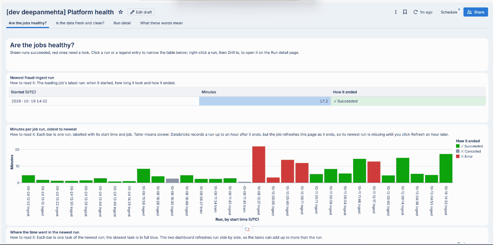](docs/img/monitoring/platform-interaction.gif)

**Fraud operations: slide the hours, then drill from an hour to the model page** (23 s loop)

[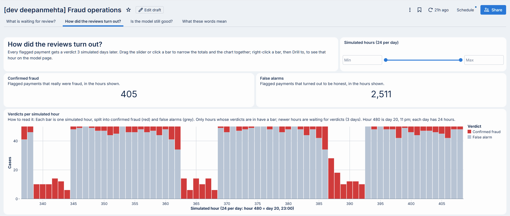](docs/img/monitoring/operations-interaction.gif)

<details open>
<summary><b>📸 Every page (12 screenshots; click any one to open it full size, or click this line to fold the gallery away)</b></summary>

| Fraud operations | |
|---|---|
| [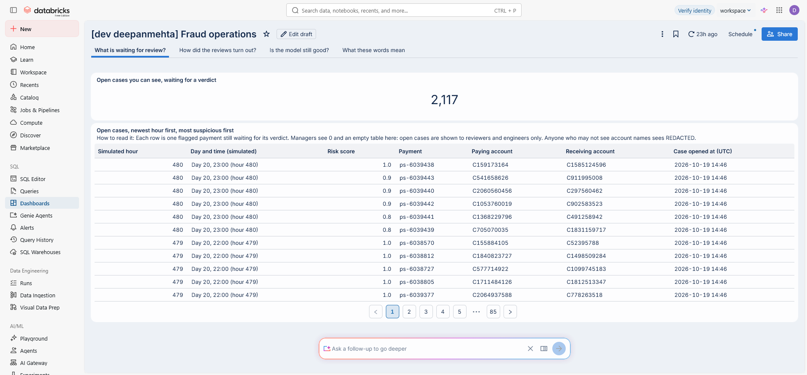](docs/img/monitoring/operations-queue.png) | [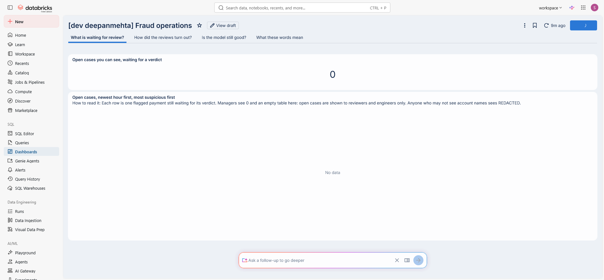](docs/img/monitoring/operations-queue-manager.png) |
| *Review queue, as an engineer: 2,117 open cases* | *The same page as a manager: 0, by design* |
| [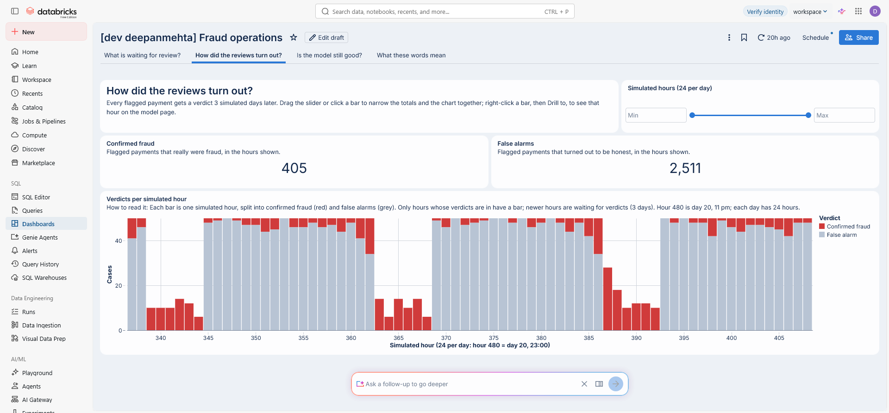](docs/img/monitoring/operations-outcomes.png) | [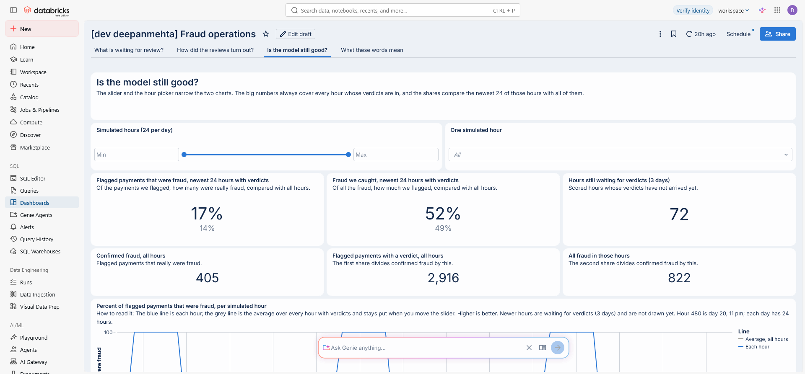](docs/img/monitoring/operations-model.png) |
| *Review outcomes: 405 confirmed fraud, 2,511 false alarms* | *Is the model still good? 17% vs 14% and 52% vs 49%* |
| [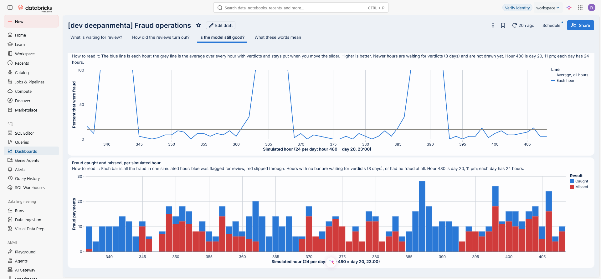](docs/img/monitoring/operations-model-per-hour.png) | [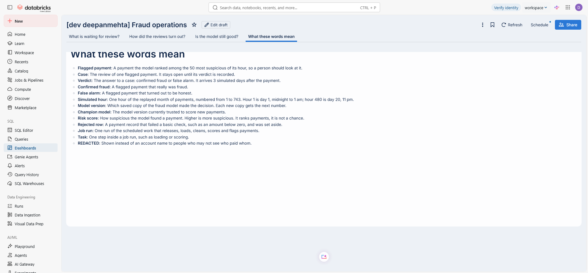](docs/img/monitoring/operations-words.png) |
| *Per hour: the share line with its average, and caught versus missed* | *What these words mean* |

| Platform health | |
|---|---|
| [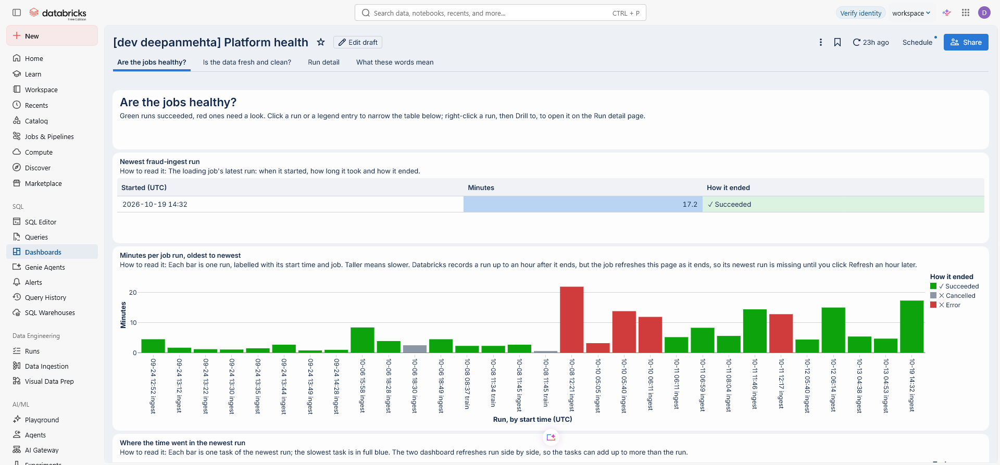](docs/img/monitoring/platform-jobs.png) | [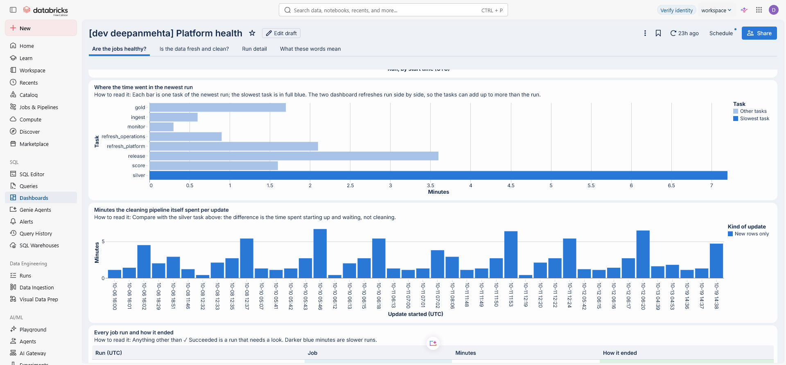](docs/img/monitoring/platform-tasks.png) |
| *Are the jobs healthy? One bar per run* | *Where the time went, and the pipeline's own minutes* |
| [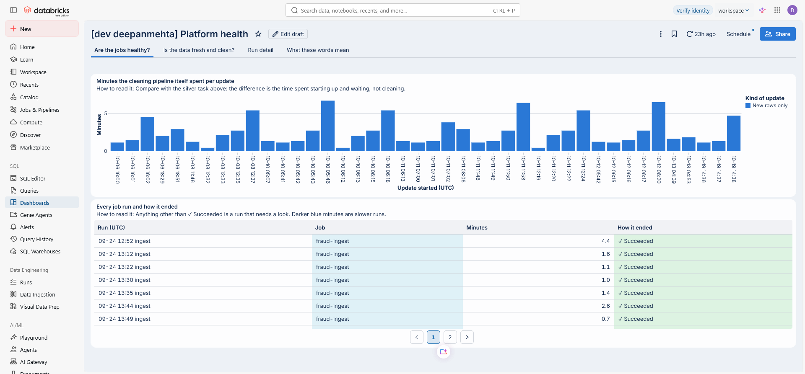](docs/img/monitoring/platform-runs.png) | [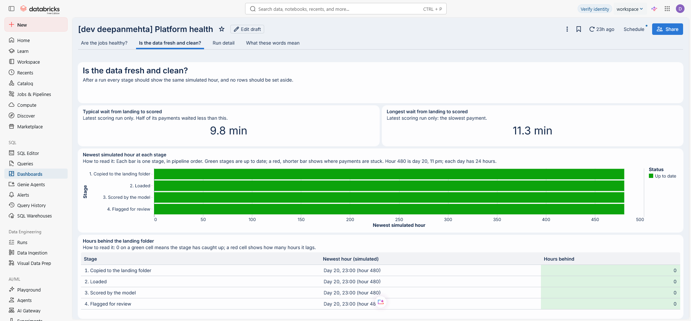](docs/img/monitoring/platform-freshness.png) |
| *Every run and how it ended* | *Is the data fresh and clean? 0 hours behind* |
| [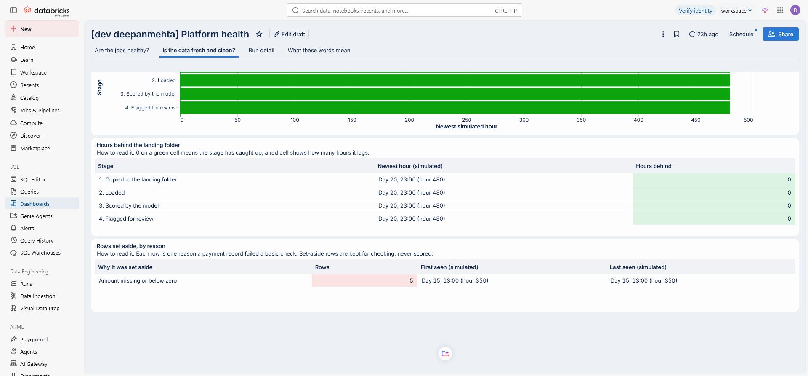](docs/img/monitoring/platform-set-aside.png) | [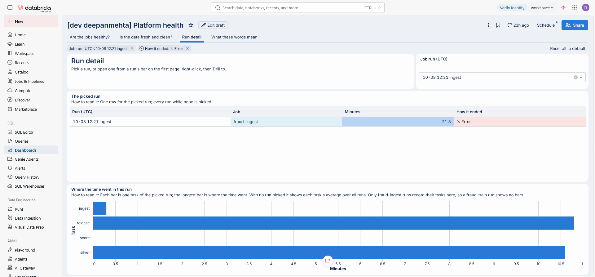](docs/img/monitoring/platform-run-detail.png) |
| *Rows set aside: 5, for an amount below zero* | *Run detail, opened by drill-through* |

</details>

💡 **What the restyle shows.**
- Colour carries meaning, never decoration: green good, red bad, grey neutral, the same on every chart, and always next to a ✓ or ✕ so it never depends on colour vision alone.
- Drill-through only offers a page that has a filter on the same data as the chart you clicked, so the model page got a one-hour picker bound to the reviews data too (D15).
- Some UI settings come back in a different shape than hand-written JSON; copying the shapes from a UI export, not guessing, fixed every invalid widget (D3, D11).

**What these words mean** (the same list ends each dashboard; a test keeps them identical):

- **Flagged payment** — A payment the model ranked among the 50 most suspicious of its hour, so a person should look at it.
- **Case** — The review of one flagged payment. It stays open until its verdict is recorded.
- **Verdict** — The answer to a case: confirmed fraud or false alarm. It arrives 3 simulated days after the payment.
- **Confirmed fraud** — A flagged payment that really was fraud.
- **False alarm** — A flagged payment that turned out to be honest.
- **Simulated hour** — One hour of the replayed month of payments, numbered from 1 to 743. Hour 1 is day 1, midnight to 1 am; hour 480 is day 20, 11 pm.
- **Model version** — Which saved copy of the fraud model made the decision. Each new copy gets the next number.
- **Champion model** — The model version currently trusted to score new payments.
- **Risk score** — How suspicious the model found a payment. Higher is more suspicious. It ranks payments, it is not a chance.
- **Rejected row** — A payment record that failed a basic check, such as an amount below zero, and was set aside.
- **Job run** — One run of the scheduled work that releases, loads, cleans, scores and flags payments.
- **Task** — One step inside a job run, such as loading or scoring.
- **REDACTED** — Shown instead of an account name to people who may not see who paid whom.
- **Landing folder** — Where each simulated hour's file of payments arrives before it is loaded.
- **Pipeline update** — One run of the cleaning step that turns loaded payments into clean ones.
- **Full rebuild** — A pipeline update that redoes everything from the start instead of only the new rows.
- **Run detail** — A page showing one job run task by task. Open it from a run's bar: right-click, then Drill to.

---

## 🧩 Key Design Choices

The engineering decisions behind each layer. Every row links to an ADR with
the evidence and the alternatives rejected. Full narrative:
[`docs/ENGINEERING-DECISIONS.md`](docs/ENGINEERING-DECISIONS.md).

| Layer | Choice | Why | What production would add |
|---|---|---|---|
| Ingest | Replay the data as hourly files and ingest with Auto Loader, not Kafka ([ADR 0007](docs/adr/0007-file-based-ingest-with-auto-loader.md)) | Free Edition blocks outbound connections to an external broker (measured); files keep every step reproducible | A message bus (Kafka/Event Hubs) with sub-second delivery |
| Ingest | `Trigger.AvailableNow` jobs instead of an always-on stream ([ADR 0003](docs/adr/0003-streaming-trigger-model-on-serverless.md)) | The only streaming trigger serverless jobs support; no compute burns between file drops | Continuous streaming on dedicated compute where latency matters |
| Ingest | Pinned schema hints, `addNewColumns` evolution and rescued data | A bad value or a new column never silently breaks or drops data; it fails once by design and retries | Schema-registry contracts with the producing team |
| Ingest | A deterministic `transaction_id` stamped at the source | PaySim has no ID; a content hash would merge genuinely identical payments | IDs issued by the payment system itself |
| Ingest | Time-based train/score cut inside days 1–17 ([ADR 0006](docs/adr/0006-paysim-dataset-instead-of-synthetic-identifiers.md)) | Measured: normal volume collapses after day 17, so a later cut would compare a 0.1% fraud rate with 1.5% | The same rule: always split by time, never randomly |
| Silver | A Lakeflow declarative pipeline of materialized views ([ADR 0008](docs/adr/0008-silver-on-a-declarative-pipeline.md)) | Late files correct the results on the next refresh with no hand-written recompute logic; incremental refresh measured | Streaming tables with stateful dedup at bank scale |
| Silver | Verdict-then-split quarantine: warn expectations, a rejected shelf with the reason, fail-loud guards | Bad rows are counted and kept for review, never silently dropped; the row accounting must reconcile exactly | Alerting on rejected-row spikes (Phase 6b here) |
| Silver | Keep the first arrival, drop identical copies, reject conflicting ones; no upsert | Payments are immutable events: a changed copy is a data problem, not a newer version | The same, plus a watermark-bounded streaming dedup |
| Silver | Warning signs on the receiving account, from earlier hours only | Measured: senders almost never repeat, receivers do (the "mule" pattern); same-hour data would leak the future | An online feature store with millisecond lookups |
| Silver | Zero amounts allowed | All 4 zero-amount payments in the data are fraud; a "positive amount" rule would throw real fraud away | Rules reviewed with the fraud-operations team |
| ML | Batch scoring as a job task after Silver, not a serving endpoint ([ADR 0009](docs/adr/0009-batch-scoring-with-mlflow-and-unity-catalog.md)) | Online feature lookups are unsupported on Free Edition, and data arrives hourly; each load is scored in the same run | A low-latency endpoint fed by an online feature store |
| ML | Alerts are the top 50 per simulated hour, not a probability cut-off | A review team's capacity is fixed; a cut-off lets the alert count swing with traffic | Budgets tuned with the fraud-operations team, per channel |
| ML | `@champion` / `@challenger` aliases in the Unity Catalog registry, moved by an explicit promotion | Scoring loads the alias, so a promotion needs no redeploy; every score names its version | A CI gate with automated checks before promotion |
| ML | A label-delay setting: train without the last 3 days of labels | Real fraud labels arrive late; measured cost here: 1 caught fraud and 0.033 PR-AUC | Delays matched to real chargeback timing (weeks) |
| ML | Gradient-boosted trees against a logistic baseline, chosen on a later time window | Never a random split; the trees won both training runs and beat every baseline in the test period | Hyperparameter search and more model families |
| ML | All fraud plus a 10% sample of the rest, with class weights | Fraud is ~0.1% of payments; sampling keeps training fast and in memory, and scores are read as rankings | Calibrated probabilities on an unsampled holdout |
| ML | One tested feature builder for training, scoring and evaluation | Training and scoring can't drift apart, and the logic is unit-tested without Spark | A feature store serving both paths |
| ML | A decision log that keeps each score's inputs as the model saw them | A later correction to Silver never rewrites a past decision; audits can replay exactly | Retention rules and model-monitoring tables on the log |
| ML | The fraud label never enters scoring, enforced by a CI text guard | The score must not depend on the answer; checked in the workspace too (0 label columns) | The same, plus schema contracts on the scoring table |
| ML | No Feature Engineering client and no Spark ML | Silver's features are already point-in-time; Spark ML on serverless has a 100 MB model cap, for no gain at 6M rows | Both, once online lookups or distributed training are needed |
| Gold | An append-only alert log, not a materialized view ([ADR 0010](docs/adr/0010-gold-alert-log-and-case-table.md)) | An alert is a promise to a reviewer; a materialized view would re-pick the top 50 when late data arrives; a rerun writes 0 rows (measured) | Alerts raised per payment from a stream, into a case-management tool |
| Gold | A separate case table (current state) next to the log (what happened) | Closing a case must not edit the log; the case's own `status` column keeps the row filter simple enough for `MERGE` | Real reviewers recording verdicts, with an audit trail |
| Gold | Late payments: fill the hour's room left, else beat its lowest alert | A late fraud still reaches a reviewer without re-ranking alerts already handed out | The same rule, tuned with the fraud-operations team |
| Gold | Verdicts 72 simulated hours later, on the data's own clock | The same 3-day delay the model was trained with; reruns behave identically | Verdicts from people, arriving on real chargeback timing |
| Gold | One SQL file task on the SQL warehouse, warehouse found by name | Pure SQL needs no notebook; no warehouse ID ever lands in this public repo | A streaming Gold table or a dedicated warehouse per team |
| Governance | Three groups; a schema-wide grant for engineers, table-by-table grants for everyone else ([ADR 0011](docs/adr/0011-governance-groups-masks-and-external-export.md)) | Least privilege: a new table stays invisible to managers until someone decides to share it | Groups synced from the company's identity provider (SCIM) |
| Governance | A row filter and column masks on the tables, not dynamic views | The rule protects the table wherever it is read from, including through the summary view (measured) | Tag-based policies across every schema |
| Governance | The job identity must be an engineer, checked before any read | A masked job would store `REDACTED` for good; the Gold SQL stops instead | A service principal with its own exempt group |
| Governance | A tag-based policy probed on a scratch table, live tables kept on per-table masks | ABAC works here (measured), but mixing both on one table is listed as unsupported | Tag policies replacing per-table masks, with tagging automated |
| Governance | No account names in the designed external export | Files outside Unity Catalog can't be masked (data minimisation); R2 is unreachable here anyway | External tables for auditors, with the same rule |
| Monitoring | Six plain views rebuilt by a SQL task after every load, over Gold, Silver and `system.lakeflow` | Views store nothing, so a rerun can't double-count; the same grants and row filter apply through them | Lakehouse Monitoring tables with threshold alerts (Phases 6b, 6c) |
| Monitoring | AI/BI dashboards generated from commented Python and deployed with the bundle | CI checks the committed JSON equals the builder's output, so a dashboard can't drift silently | Dashboards owned and reviewed by an analytics team |
| Monitoring | Viewer credentials, not the publisher's | Each viewer's own grants, row filter and masks apply: the manager's queue read 0 (measured) | The same |
| Monitoring | Jobs and the pipeline matched by name, minutes from start and end times | The system tables' duration columns read 0 here (measured), and no ID lands in this public repo | Joins by ID in a fixed production workspace |
| Monitoring | Waiting hours counted from scored hours, with no share shown until verdicts arrive | A 0 would claim the model caught nothing, and the manager's row filter hides open hours | The same |
| Monitoring | AI/BI dashboards, not a custom app ([ADR 0012](docs/adr/0012-monitoring-dashboards-and-views.md)) | An app works on Free Edition (measured) but would use one of 3 app slots and re-build the per-viewer security that dashboards get from viewer credentials | A custom app for workflows a dashboard can't do, such as recording verdicts |
| Monitoring | One theme and meaning colours pinned to values on both dashboards | Green, red and grey mean the same on every chart, always beside a ✓ or ✕; the palette passed a contrast check | A company-wide dashboard theme set by an admin |
| Monitoring | Hour sliders, click-to-filter and drill-through, with a one-hour picker on the model page | Readers narrow and follow a question without editing anything; "Drill to" only offers a page with a filter on the same data (measured, D15) | The same, plus saved views per team |
| Monitoring | Hours shown as `Day 20, 23:00 (hour 480)`, never a made-up calendar date | People read a clock, not a counter; the data has no real dates, so a date would claim something false | Business time (dates, shifts) from real timestamps |
| Testing | A pure-Python reference model checks the SQL's results row for row | CI can't run Spark; the workspace runs were compared with an independent calculation | Integration tests on a dev workspace in CI |

---

## 📈 Scaling Considerations

This project runs about 6M payments on Databricks Free Edition (serverless
only, one active pipeline, an unpublished daily quota). Each choice above is
the right size for that. The table names the heavier pattern a team would
reach for as volume or latency needs grow.

| Concern | Pattern | When to adopt | In this repo now |
|---|---|---|---|
| Event delivery | Files plus Auto Loader | Batch-like arrival, minutes of latency are fine | ✅ |
| Event delivery | Kafka plus Structured Streaming | Sub-second latency or many producers | — (blocked on Free Edition, G-01) |
| Transformation | Materialized views in a triggered pipeline | Millions of rows, late data must correct results | ✅ (incremental refresh measured) |
| Transformation | Streaming tables plus stateful dedup | Continuous, high-volume, append-only streams | — |
| Features | Window features computed in Silver | Batch scoring on a schedule | ✅ |
| Features | Online feature store and point-in-time training sets | Millisecond scoring at payment time | — (online tables unsupported on Free Edition) |
| Training | Single-node scikit-learn on a sampled fit set | Millions of rows fit in one machine's memory | ✅ |
| Training | Distributed training (Spark ML or distributed boosting) | Training data outgrows one machine | — |
| Scoring | Batch scoring after each load | Minutes of latency are acceptable | ✅ |
| Scoring | Millisecond serving endpoint with an online feature store | Scoring at payment time | — (online tables unsupported on Free Edition) |
| Model lifecycle | Manual promotion between aliases | A person reviews each new version | ✅ |
| Model lifecycle | Shadow-scored challenger with automated, drift-triggered retraining | Frequent retrains, many models | 🔜 Phase 6c |
| Alerting | A SQL task after each load, top 50 per hour | Hourly batches, a fixed review team | ✅ |
| Alerting | A streaming Gold table raising alerts per payment | Alerts needed seconds after payment | — |
| Monitoring | Plain views and dashboards refreshed by the job | One team, hourly batches | ✅ |
| Monitoring | A custom monitoring app with its own service principal | Workflows beyond reading, such as recording verdicts | — (probed: an app works on Free Edition, G-21) |
| Monitoring | Streaming views with a live-refreshing dashboard | Data that changes every few seconds | — (data changes once per job run) |
| Monitoring | Lakehouse Monitoring with drift metrics and alerts | Many models and tables, an on-call rota | 🔜 Phases 6b, 6c |
| Access control | Per-table row filters and column masks | A handful of governed tables | ✅ |
| Access control | Tag-based policies (ABAC) at catalog or schema level | Many tables, new ones added often | 🟡 probed on a scratch table (G-19) |
| Job identity | The job runs as the owner, an engineer | Single developer | ✅ |
| Job identity | A service principal in its own exempt group | A team, with audited automation | 🔜 Phase 3 add-on |
| Environments | One `dev` bundle target with shared variables | Single developer | ✅ |
| Environments | dev/test/prod targets with CI deploys | A team, with promotion gates | 🔜 Phase 3 add-on |

---

## 🎓 Exam Alignment

This repo doubles as verifiable skills coverage for the **Databricks
Certified Data Engineer Associate** exam guide: 18 of 33 official items are
shown with real code or a verified run, 6 more are designed (an ADR or a
`docs/GAPS.md` row), and 9 are not started. See the full breakdown in
[`docs/exam-guide-map.md`](docs/exam-guide-map.md), and the study notes
building toward it in [`docs/concepts/`](docs/concepts/). This is a skills
coverage map, not exam prep. Several ✅ rows are partial rather than
complete — the map's Skill column always says exactly what is and isn't
shown.

---

## ⚠️ Known Limitations

- **Single verification day**: Phase 2 figures are single runs, not averages. The daily compute quota is unpublished. Phase 2's runs fit inside one day's allowance; on 2026-10-08, after a day of Phase 4 runs (deploy, two training runs, two job runs), a job's Silver step was refused with `CLUSTER_CREATION_RESOURCE_EXHAUSTED`, and on 2026-10-10 the limit was reached after three full ingest-and-score job runs. On 2026-10-11, four job runs, three evaluation runs and several SQL checks fit, and the fifth job run was refused. A job run with nothing new still costs time: on 2026-10-12 the Silver pipeline step alone took 11m 45s with no new data. So heavy verification days are split across days (G-08)
- **scikit-learn installed at run time**: serverless job tasks can land on different environment versions (5 ships scikit-learn 1.6.1, 6 ships 1.7.2), and a bundle deploy did not keep a job-level environment on a notebook task (measured 2026-10-10). So the training, scoring and evaluation notebooks run `%pip install scikit-learn==1.7.2` first. The version is exact but not hash-locked, and a guard still stops scoring if the model's version differs. MLflow is not pinned: job tasks got 3.8.1 and training 3.12.0, and loading worked across them (GAPS §3, M-MLFLOW)
- **Scores are rankings, not probabilities**: the model is trained on all fraud plus a 10% sample of the rest, so `risk_score` orders payments but isn't a calibrated chance of fraud (GAPS §3, M-RANK)
- **Platform health is one run behind until refreshed**: Databricks records a job run in its system tables up to an hour after it ends, but the job refreshes the dashboard as it ends. So the newest run appears only after a manual Refresh about an hour later (measured on run E, 2026-10-19); an hourly schedule was rejected because it would spend the daily compute allowance (G-08, GAPS §3 MON-LAG, MON-REFRESH)
- **No live auto-refresh and no single-payment drill-down**: an open dashboard shows the data as of the last job run or Refresh, and the deepest drill is one job run or one simulated hour, not one payment (GAPS §3, MON-REFRESH, MON-DRILL)
- **A click can blank a total**: clicking the red or grey part of a stacked reviews bar also picks that verdict, so the other total shows "No data". This is Databricks' normal click-to-filter, and the page says so (GAPS §3, MON-CLICK)
- **No real-time scoring**: payments are scored when the job runs after their file lands, not at payment time (GAPS §3, M-BATCH)
- **Manual promotion**: a person moves `@champion` with a notebook; there is no CI gate, no shadow scoring and no automatic retraining yet (GAPS §3, M-PROMOTE)
- **Model leans on simple signals**: amount, hour of day and payment type carry most of the weight, and the receiver-history features aren't in the top 5. The hour-of-day effect is a PaySim artefact (measured: clock hours 0–7 hold 31% of training fraud but 1.2% of normal payments), so it wouldn't carry over to real traffic (GAPS §3, M-QUIET)
- **Quiet hours inflate recall**: 18 of the 72 test hours have fewer than 50 payments, all fraud, so every approach catches those 216 for free. Recall in the 54 full hours is 0.312 for the champion, against 0.493 overall (GAPS §3, M-QUIET)
- **Invalid JSON loses its text**: a line that is not valid JSON lands in Bronze as one all-null row (its text is lost, and the run succeeds). Silver rejects such a row as `missing_id` onto the rejected shelf, so it is visible there, but the original text cannot be recovered (GAPS §3, V5)
- **Hourly features and warm-up**: PaySim time is in whole hours, so the features count earlier hours only, never the same hour. The first 24 hours have partial history (GAPS §3, S-HOURS)
- **SQL logic is not unit-tested in CI**: CI checks the Silver and Gold SQL's structure (names, frames, column lists, insert-only writes, guards). The logic is proven by the workspace runs against the two reference models (GAPS §3, CI-SQL)
- **Reset needs a manual full refresh**: after a Bronze reset, Silver keeps its old results until someone clicks **Full refresh all** on the pipeline (GAPS §3, S-RESET)
- **Batch-sized Silver**: materialized views fit 6M rows. At bank scale this would be streaming tables plus a feature store with online lookups (ADR 0008)
- **No external tables on this tier**: an external table on a Cloudflare R2 bucket was designed (`sql/gold/export.sql`), but Free Edition's serverless compute can't resolve R2's storage domain (measured 2026-10-11), so all tables are managed (G-18)
- **No Kafka on this tier**: serverless compute cannot even resolve untrusted hostnames (measured), so Confluent Kafka is out. Events are replayed as files instead (G-01)
- **Not sub-second streaming**: Real-Time Mode needs classic compute. Serverless supports `AvailableNow` and Lakeflow pipelines only (G-02)
- **Synthetic, uneven data**: PaySim is a simulation. Legitimate volume collapses after simulated day 17 while fraud stays constant, so days 1–17 are used for training and scoring, and days 18–31 are held back as a drift scenario (G-10)
- **Storage duplication**: landing files are kept after ingest, so the data sits in the workspace about three times (CSV, outbox, landing) plus Bronze. There is no stated storage quota; `cleanSource` archiving is not yet implemented
- **Retry with changed flags**: if a failed release is retried with different scenario flags, a step can land twice; recovery is `99_reset`
- **Simulated verdicts**: cases close with the dataset's label as the verdict, 72 simulated hours later; no person reviews anything (GAPS §3, G-SIM)
- **One person plays every role**: the owner is an engineer and a reviewer, and one test user stands in for a manager and an outsider (GAPS §3, G-ROLES)
- **The job runs as the owner**, not a service principal; the Gold SQL refuses to run if that identity isn't an engineer (GAPS §3, G-RUNAS)
- **Late payments shown in tests only**: each replayed hour is one file, so a single payment never arrives after its hour was alerted. The workspace proved a late *hour*; the late-payment rule is proven by the calculator and a SQL guard (GAPS §3, G-LATE)
- **Tag-based policy on a scratch table only**: the live Gold tables keep per-table masks, because mixing both on one table is listed as unsupported (GAPS §3, G-POLICY)
- **No open research gaps**: all 22 rows in [`docs/GAPS.md`](docs/GAPS.md) are resolved. The total cost is ₹0 (G-09); the real limit is the unpublished daily compute quota (G-08)
- **Exam items out of scope for this project**: 2.2 (COPY INTO), 2.4 (Lakeflow Connect) and 2.5 (JDBC/ODBC/REST landing) are not planned — see [`docs/exam-guide-map.md`](docs/exam-guide-map.md) for why
- **Keyless CI/CD unavailable**: Keyless OIDC deploys from GitHub Actions need a Databricks account console, which Free Edition does not have, so CI deploys will use a stored credential in a protected GitHub environment instead ([docs](https://docs.databricks.com/aws/en/dev-tools/auth/oauth-federation-policy), checked 2026-09-27)

---

## 🔜 Roadmap

- [x] Phase 0: research and ADRs (22 of 22 gaps resolved; ADRs proposed, awaiting review)
- [x] Phase 1: scaffolding and CI
- [x] Phase 2: ingest to Bronze (44 unit tests at ship; workspace V1–V6 verified 2026-09-24)
- [x] Phase 3: Silver (quality rules with quarantine, dedup on `transaction_id`, strict-past velocity features; workspace S1–S6 verified 2026-10-06/07)
- [ ] Phase 3 add-on: dev and prod bundle targets, and CI deploys from a protected GitHub environment (exam items 5.2, 5.4)
- [x] Phase 4: ML training and batch scoring (champion catches 405 of 822 frauds at 50 alerts per hour; workspace M1–M8 verified 2026-10-08 to 2026-10-11)
- [x] Phase 5: Gold alerts and Unity Catalog governance (3,154 then 3,268 alerts, every count matching the calculator; manager access proven with a second user; workspace G1–G11 verified 2026-10-11 to 2026-10-13)
- [x] Phase 6a: monitoring view, `v0.5.0` (two AI/BI dashboards, restyled with sliders, click-to-filter and drill-through; workspace D1–D17 verified 2026-10-15 to 2026-10-28)
- [ ] Phase 6b: job alerting, `v0.6.0`
- [ ] Phase 6c: model monitoring, `v0.7.0`
- [ ] Phase 7: live demo window and teardown, `v1.0.0`
- [x] Databricks Data Engineer Associate coverage map

---

## 📂 Dataset

**[PaySim](https://www.kaggle.com/datasets/ealaxi/paysim1)** mobile-money
transaction simulator · licence **CC BY-SA 4.0** · chosen in ADR 0006 over
the originally planned Kaggle Credit Card Fraud dataset (G-04).

| Property | Value (verified from the downloaded file) |
|---|---|
| Rows | 6,362,620 |
| Fraud (`isFraud=1`) | 8,213 (~0.129%) |
| Flagged fraud (`isFlaggedFraud=1`) | 16 |
| Time span | steps 1–743, 1 step = 1 hour (~30 days) |
| Columns | `step, type, amount, nameOrig, oldbalanceOrg, newbalanceOrig, nameDest, oldbalanceDest, newbalanceDest, isFraud, isFlaggedFraud` |

⚠️ The balance columns leak the label (they are zeroed after fraud), so they
are excluded from features (ADR 0006). Volume is not uniform over time (G-10).

---

## 📜 License

Released under the MIT License. See [`LICENSE`](LICENSE).

---

## 👤 Author

**Deepan Mehta**

- Data Analytics → Data Engineering → AI/ML Engineering
- Focused on building end-to-end data and ML systems combining analytics, automation, and deployment
- Experience in ETL pipelines, streaming ingest, predictive modelling, and analytical databases

🔗 GitHub: [deepan-mehta-analytics](https://github.com/deepan-mehta-analytics)
